<picture>
  <source media="(prefers-color-scheme: dark)" srcset="assets/banner-dark.svg">
  
</picture>

<p align="center">
  <a href="https://www.linkedin.com/in/paulhgeorge"></a>
  <a href="mailto:paulhgeorge@student.ie.edu"></a>
  <a href="https://github.com/paulhgeorge-creator/sentinel"></a>
</p>

```ts
const paul = {
  role:      "Forward Deployed Engineer Intern @ Pawl",
  studying:  "Dual Master's, Management & FinTech @ IE University (AI concentration)",
  focus:     ["AI product development", "data quality", "security"],
  stack:     ["Python", "SQL", "TypeScript"],
  roles:     ["Tech Officer @ Google Developer Group", "IE Planet Fellow"],
  podiums:   5,
  sideQuest: "CFA Level I",
};
```

## ◆ Competitions

| | Competition | Result |
|:-:|---|---|
| 🥇 | **Citi Corporate Banking Game** | 1st place |
| 🥈 | **IE Venture Mind AI Hackathon** | 2nd of 150+ MBA, PhD and undergraduate participants. Individual: built and pitched a defensible business case to a panel of active investors |
| 🥈 | **Cursor AI Hackathon** | 2nd of 180+ participants. Shipped a working product in 24h → [Sentinel](https://github.com/paulhgeorge-creator/sentinel) |
| 🥈 | **AstraZeneca Tech Lab Challenge** | 2nd of 20+ teams (120+ participants) in a tech consulting contest |
| 🏁 | **Google Hackathon** | Finalist: 1 of 10 teams (from 40+) selected to pitch at Google HQ → [Arcadia](https://github.com/paulhgeorge-creator/Arcadia) |

## ◆ Featured — Sentinel

<table>
<tr>
<td width="62%" valign="top">

**Real-time crisis navigation for civilians in conflict zones.**
🥈 2nd place, IE University Cursor AI Hackathon, March 2026 (built with a team).

- **Field Mode** (mobile): live hazard map, community reports, danger-weighted safe routes, SOS
- **Intelligence Mode** (desktop): 3D globe with flights, seismic activity and satellites
- **Data:** ACLED · OpenSky · USGS · Celestrak · OSRM · Supabase Realtime
- **My part:** the RAG pipeline: ingestion, chunking, Gemini embeddings, vector store, hallucination guardrails

[**→ Quick start**](https://github.com/paulhgeorge-creator/sentinel#quick-start)

</td>
<td width="38%" valign="top">

**Problem**
Civilians lack a simple live view of hazards and safe routes. NGOs lack a shared picture of the situation.

**Stack**
<br>


</td>
</tr>
</table>

## ◆ More builds

<table>
<tr>
<td width="50%" valign="top">

### [📊 Investment Risk Dashboard](https://github.com/paulhgeorge-creator/personal-finance-dashboard)
Compare risk, volatility and returns across savings, bonds, index funds and crypto.

`Next.js` `TypeScript` `Tailwind` `shadcn/ui`

</td>
<td width="50%" valign="top">

### [🛡️ Intrusion Detection System](https://github.com/paulhgeorge-creator/Traditionally-Coded-Intrusion-Detection-System-1.0)
Signature-based packet sniffer written from scratch for security practice.

`Python` `Networking` `Security`

</td>
</tr>
</table>

## ◆ Leadership

<table>
<tr>
<td width="50%" valign="top">

### 🧑‍💻 Tech Officer · Google Developer Group
Organizing a hackathon and speaker series for the IE tech community.

</td>
<td width="50%" valign="top">

### 🌍 IE Planet Fellow
Deployed LLM and process-mining automation connecting 500+ alumni with active VC and angel investors.

</td>
</tr>
</table>

## ◆ Toolkit

<p>
  
</p>

Also: **Tableau** · **Excel** · **SQL** · **RAG / LLM pipelines**

## ◆ Background

| | |
|---|---|
| 🎓 **IE University**, Madrid | Dual Master's in Management & Financial Technology · AI concentration · 2025–2027 |
| 🎓 **Syracuse University** | BA&S, International Relations & Global Political Economics · 2020–2024 |


